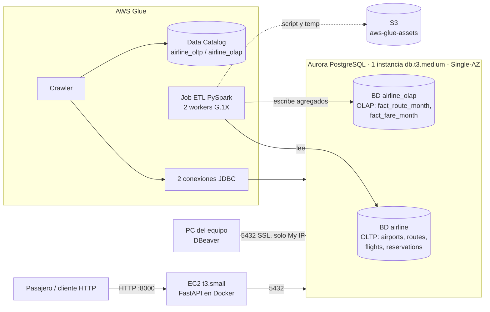

# Arquitectura AWS — Parcial 1 (propuesta)

Cuenta: AWS Academy Learner Lab (rol **LabRole**, presupuesto US$50, región us-east-1).
Criterio: lo más simple y barato que cumpla el enunciado y que se pueda **reutilizar en el parcial 2**.

## Componentes

| Componente | Decisión | Por qué |
|---|---|---|
| Base transaccional (OLTP) | Aurora PostgreSQL, BD `airline` | La pide el profesor. PostgreSQL da bloqueo de fila para evitar la sobreventa (RNF de concurrencia) |
| Base analítica (OLAP) | **Segunda base de datos `airline_olap` en el mismo cluster** | El enunciado pide "una segunda base PostgreSQL", no un segundo servidor. Un segundo cluster duplicaría el costo (~US$60 más al mes) y se saldría del presupuesto |
| Instancia Aurora | 1 writer db.t3.medium, sin réplica, Single-AZ | Es la clase más pequeña de Aurora PostgreSQL. En un laboratorio la alta disponibilidad no justifica pagar el doble |
| Backend | EC2 t3.small + Docker Compose (solo la API) | Es lo más barato y se reutiliza tal cual en el parcial 2 (R1, R2, R11). Elastic Beanstalk o ECS agregan servicios y costo |
| ETL | Job de AWS Glue (PySpark) | Es el servicio de ETL del curso. Lee las tablas del catálogo, **agrega** por ruta, mes y tarifa, y escribe en `airline_olap`. Usa LabRole, así que no hay que crear roles |
| Catálogo | Glue Data Catalog con 2 bases (`airline_oltp`, `airline_olap`) llenadas por un crawler JDBC | Lo exige el 5.7 |
| Frecuencia del ETL | **Bajo demanda** en el laboratorio; en producción, diario de madrugada | Un trigger programado fallaría con el cluster detenido. Datos de un día de antigüedad bastan para un tablero gerencial |
| Acceso con DBeaver | Aurora con *Public access* y el puerto 5432 abierto solo a la IP del equipo, con SSL | Es la forma más simple de conectar DBeaver. La alternativa es un túnel SSH por la EC2 |

## Modelo analítico (OLAP)
Se transforma y agrega durante el ETL, no se copia tal cual. Sale desnormalizado para que las consultas
gerenciales no necesiten joins:

- `fact_route_month(route, month, seats_capacity, seats_sold, occupancy, revenue_cents, bookings, cancellations)`:
  ocupación por ruta. Tiene las mismas columnas que `route_month_metrics` del parcial 2.
- `fact_fare_month(fare_class, month, revenue_cents, bookings, cancellations, cancel_rate)`: ingresos por
  tarifa y patrones de cancelación.

## Red y seguridad (VPC por defecto)
- **Security group `airline-db-sg`**, que va en Aurora y en la conexión de Glue:
  - 5432 desde la IP del equipo, para DBeaver.
  - 5432 desde el SG de la EC2, para la API.
  - Todo TCP desde sí mismo. Glue lo exige: sus ENI hablan entre ellas y con la BD.
- **VPC endpoint Gateway de S3**, que es gratis. Glue corre dentro de la VPC sin IP pública y lo necesita
  para leer su script desde S3. **No se usa NAT Gateway**, que costaría ~US$33 al mes y está prohibido
  en R11 del parcial 2.
- **Security group `airline-api-sg`** para la EC2: 8000 abierto al público y 22 desde la IP del equipo.
- La cadena de conexión con la contraseña se guarda **cifrada en SSM Parameter Store**
  (`/airline/database_url`, nivel estándar gratuito). La EC2 la lee al arrancar usando LabInstanceProfile.
  Glue toma las credenciales de su conexión JDBC. Nada queda en GitHub ni en el código.
- El almacenamiento de Aurora va cifrado con la llave KMS administrada por AWS.
- SSL: DBeaver y la API se conectan con `sslmode=require`. En el servidor `rds.force_ssl=0`, para que
  Glue se conecte sin instalar el certificado de RDS. Ese tráfico nunca sale de la VPC. Es un
  compromiso consciente entre simplicidad y seguridad, y conviene mencionarlo en la sustentación.

## Costos estimados (us-east-1, precios públicos aproximados)

| Servicio | Supuesto | 24/7 al mes | Uso real de laboratorio (~60 h/mes) |
|---|---|---|---|
| Aurora db.t3.medium | US$0.082/h | US$59.9 | US$4.9 |
| Almacenamiento + I/O Aurora | <5 GB, <1 M de I/O | US$0.7 | US$0.7 |
| EC2 t3.small + 8 GB gp3 | US$0.0208/h | US$15.8 | US$1.9 |
| Job Glue | 2 DPU × 2 min × 30 ejecuciones a US$0.44/DPU-h | US$0.9 | US$0.2 |
| Crawler Glue | ~4 ejecuciones de 10 min mínimo | US$0.3 | US$0.3 |
| Data Catalog | <1 M de objetos (capa gratuita) | US$0 | US$0 |
| S3 y endpoint Gateway | <1 GB; el endpoint es gratis | US$0.1 | US$0.1 |
| **Total** | | **~US$78** | **~US$8** |

**Prendido 24/7, el presupuesto de US$50 se acaba en unas 3 semanas**, casi todo por Aurora. Por eso,
al terminar cada sesión: detener el cluster (Stop temporarily) y la EC2.

**Escenario ×10 (volumen de datos o frecuencia):**
- El almacenamiento y el I/O crecen de forma lineal, pero siguen siendo centavos.
- El job de Glue pasa a ~US$9 al mes: crece lineal con el volumen, o con la frecuencia si corre 10 veces al día.
- El cambio grande es la instancia. Con 10 veces más datos y consultas, db.t3.medium se queda corta en
  memoria y habría que pasar a db.r6g.large (~US$190 al mes).
- La alternativa para la parte analítica es **Aurora Serverless v2**, que puede escalar a 0 ACU
  cuando no hay uso, o mover el análisis a S3 + Athena, que es lo que hace el parcial 2.

Esto se relaciona con dos pilares del Well-Architected Framework. **Optimización de costos:** se paga
por uso y se apaga lo que no se usa. **Sostenibilidad:** no hay recursos ociosos y la instancia tiene
el tamaño de la carga real.
